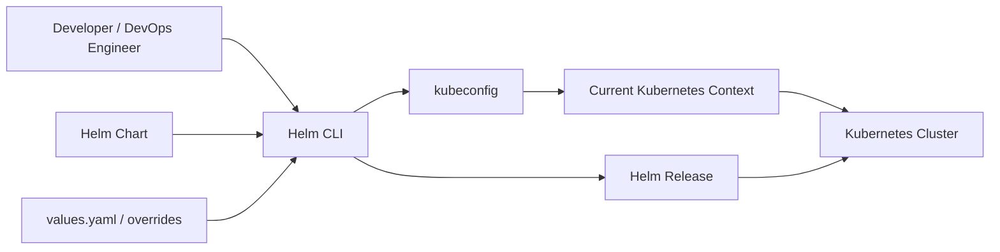

## Helm-Guide

**File:** `README.md`

A structured Helm guide for developers, DevOps engineers, SREs, and infrastructure engineers covering Kubernetes package management, Helm architecture, installation, charts, repositories, releases, templates, values, chart dependencies, hooks, upgrades, rollbacks, best practices, troubleshooting, and interview questions.

## Table of Contents

- [About](#about)
- [What You Will Learn](#what-you-will-learn)
- [Why Helm](#why-helm)
- [Helm Architecture at a Glance](#helm-architecture-at-a-glance)
- [Repository Structure](#repository-structure)
- [Prerequisites](#prerequisites)
- [Tools and Technologies](#tools-and-technologies)
- [Documentation Roadmap](#documentation-roadmap)
- [Practical Example](#practical-example)
- [Helm Version and Compatibility Notes](#helm-version-and-compatibility-notes)
- [Classic Helm Repository vs OCI](#classic-helm-repository-vs-oci)
- [Recommended Learning Flow](#recommended-learning-flow)
- [Validation Checklist](#validation-checklist)
- [Final Outcome](#final-outcome)

## About

Helm is a package manager for Kubernetes.

The easiest analogy is:

| Linux                   | Kubernetes                           |
|-------------------------|--------------------------------------|
| APT/YUM                 | Helm                                 |
| `.deb` / `.rpm` package | Helm chart                           |
| Package repository      | Helm chart repository / OCI registry |
| Installed package       | Helm release                         |
| Package configuration   | Helm values                          |
| Package upgrade         | Helm upgrade                         |
| Package removal         | Helm uninstall                       |

For example, Ubuntu can install software with:

```bash
sudo apt update
sudo apt install nginx
```

Helm provides a similar experience for Kubernetes applications:

```bash
helm repo add bitnami https://charts.bitnami.com/bitnami
helm repo update

helm install my-nginx bitnami/nginx
```

The key difference is that Helm is not simply installing a single binary. A Helm chart can package the Kubernetes resources required to deploy an application or platform component, such as:

- Deployments
- StatefulSets
- DaemonSets
- Services
- ConfigMaps
- Secrets
- ServiceAccounts
- Ingresses
- HorizontalPodAutoscalers
- Jobs
- Custom Resources
- Supporting configuration

## What You Will Learn

This repository follows a practical progression:

1. Understand what Helm is.
2. Understand why Helm is useful.
3. Understand Helm charts.
4. Understand Helm repositories.
5. Understand Helm releases.
6. Install Helm.
7. Understand Kubernetes context selection.
8. Deploy third-party applications with Helm.
9. Customize charts using values.
10. Upgrade releases.
11. Uninstall releases.
12. Create organizational Helm charts.
13. Package charts.
14. Generate a classic Helm repository.
15. Publish the repository.
16. Consume the repository.
17. Understand chart dependencies.
18. Understand templates and `values.yaml`.
19. Understand `--set`.
20. Understand `helm show values`.
21. Apply Helm to real-world AWS/Kubernetes components.
22. Practice troubleshooting and interview scenarios.

## Why Helm

Without Helm, a DevOps team can end up maintaining:

- Multiple Kubernetes YAML files.
- Installation scripts.
- Environment-specific manifests.
- Version-specific scripts.
- Upgrade procedures.
- Rollback procedures.
- Dependency-installation logic.
- Documentation explaining the correct installation order.

For example, installing a monitoring stack manually could require:

```text
Namespace
   |
   +--> ServiceAccount
   |
   +--> ConfigMap
   |
   +--> Deployment / StatefulSet
   |
   +--> Service
   |
   +--> RBAC
   |
   +--> PersistentVolumeClaim
   |
   +--> ServiceMonitor / Custom Resources
```

Helm packages these resources into a reusable deployment unit.

### Real-world scenario

Suppose:

- Team A needs Argo CD version 2.12.
- Team B needs another supported version.
- UAT requires 2 replicas.
- Production requires 3 replicas.

Instead of maintaining many manually duplicated YAML files, a Helm chart can expose configurable values:

```yaml
replicaCount: 3
```

and:

```bash
helm upgrade --install argocd ./argocd \
  --set replicaCount=3
```

The same chart can therefore be reused across environments.

## Helm Architecture at a Glance



Helm runs primarily as a client-side CLI. With Helm 3 and later, there is no Tiller server that must be installed inside the Kubernetes cluster.

## Repository Structure

```text
Helm-Guide/
│
├── .gitignore
├── README.md
│
├── docs/
│   ├── 01-what-is-helm.md
│   ├── 02-components-of-helm.md
│   ├── 03-deploy-helm-chart.md
│   └── 04-create-helm-chart.md
│
├── examples/
│   └── best-commerce/
│       ├── payments/
│       │   ├── templates/
│       │   │   ├── tests/
│       │   │   │   └── test-connection.yaml
│       │   │   ├── _helpers.tpl
│       │   │   ├── deployment.yaml
│       │   │   ├── hpa.yaml
│       │   │   ├── ingress.yaml
│       │   │   ├── service.yaml
│       │   │   └── serviceaccount.yaml
│       │   ├── .helmignore
│       │   ├── Chart.yaml
│       │   ├── NOTES.txt
│       │   └── values.yaml
│       │
│       └── shipping/
│           ├── templates/
│           │   ├── tests/
│           │   │   └── test-connection.yaml
│           │   ├── _helpers.tpl
│           │   ├── deployment.yaml
│           │   ├── hpa.yaml
│           │   ├── ingress.yaml
│           │   ├── service.yaml
│           │   └── serviceaccount.yaml
│           ├── .helmignore
│           ├── Chart.yaml
│           ├── NOTES.txt
│           └── values.yaml
│
└── charts/
    ├── index.yaml
    ├── payments-0.1.0.tgz
    └── shipping-0.1.0.tgz
```

## Prerequisites

Install:

- Helm
- kubectl
- A Kubernetes cluster
- Git
- A container image runtime if creating a local cluster
- GitHub account for the repository-hosting exercise

A local Kubernetes cluster can be provided by:

- kind
- Minikube
- Docker Desktop Kubernetes
- Rancher Desktop
- An existing cloud Kubernetes cluster such as EKS or AKS

## Tools and Technologies

| Tool                         | Purpose |
|------------------------------|----------------------------------------|
| Helm                         | Kubernetes package management          |
| kubectl                      | Kubernetes CLI                         |
| Git                          | Source control                         |
| GitHub                       | Source/repository hosting              |
| GitHub Pages                 | Static classic Helm repository hosting |
| BusyBox                      | Lightweight demonstration container    |
| NGINX                        | Third-party deployment example         |
| Bitnami                      | Example third-party chart repository   |
| AWS EKS                      | AWS Kubernetes platform                |
| AWS Load Balancer Controller | Kubernetes/AWS integration             |
| Nexus / Artifactory          | Enterprise artifact hosting options    |
| OCI registry                 | Modern chart distribution mechanism    |

## Documentation Roadmap

### `docs/01-what-is-helm.md`

Covers:

- What Helm is
- Package-manager analogy
- Why Helm
- Helm installation
- Helm 2 vs Helm 3+
- Kubernetes contexts
- Basic Helm workflow

### `docs/02-components-of-helm.md`

Covers:

- Charts
- Repositories
- Releases
- `Chart.yaml`
- `values.yaml`
- `templates/`
- `charts/`
- Dependencies
- Release lifecycle

### `docs/03-deploy-helm-chart.md`

Covers:

- Adding repositories
- Searching charts
- Installing NGINX
- Customizing values
- Rendering templates
- Upgrading releases
- Uninstalling releases
- AWS Load Balancer Controller example

### `docs/04-create-helm-chart.md`

Covers:

- Creating Payments and Shipping charts
- BusyBox demonstration
- Template customization
- Values
- Packaging
- `index.yaml`
- GitHub Pages
- Chart consumption
- Validation
- Cleanup
- Enterprise distribution considerations

## Practical Example

The `best-commerce` example represents an e-commerce organization with two microservices:

```text
best-commerce
├── payments
└── shipping
```

Both services use BusyBox for demonstration.

The image is intentionally simple:

```text
busybox
```

The application behavior is simulated through:

```bash
echo "Payments Service"
sleep 3600
```

and:

```bash
echo "Shipping Service"
sleep 3600
```

This avoids introducing unnecessary application source code into a Helm-focused exercise.

## Helm Version and Compatibility Notes

### Helm 4 — Current

Helm 4 is the current stable major release.

Use the current Helm documentation and release information when installing new environments.

### Helm 3 — Existing production environments

Helm 3 remains important because many existing enterprise environments use it. It removed the Tiller architecture used by Helm 2.

### Helm 2 — Legacy / Deprecated

Helm 2 required a server-side component called **Tiller**.

```text
Helm 2

Helm CLI
   |
   v
Tiller
   |
   v
Kubernetes API
```

This architecture is no longer appropriate for new installations.

### Helm 3+

```text
Helm CLI
   |
   v
Kubernetes API
```

No Tiller installation is required.

## Classic Helm Repository vs OCI

The repository example in this guide uses the classic repository model:

```text
HTTP server
   |
   +-- index.yaml
   |
   +-- chart-0.1.0.tgz
   +-- chart-0.2.0.tgz
```

This is still supported.

However, modern Helm also supports OCI registries, and OCI distribution is generally preferable for new enterprise artifact workflows when the organization already operates an OCI registry. OCI support became generally available in Helm 3.8.0.

Examples include:

- Amazon ECR
- Azure Container Registry
- Harbor
- JFrog Artifactory
- Google Artifact Registry
- Docker Hub
- Other OCI-compatible registries

## Recommended Learning Flow

```text
What is Helm
     |
     v
Why Helm
     |
     v
Charts
     |
     v
Repositories
     |
     v
Releases
     |
     v
Install Helm
     |
     v
Install third-party chart
     |
     v
Customize values
     |
     v
Upgrade / Rollback
     |
     v
Create own chart
     |
     v
Package chart
     |
     v
Create repository
     |
     v
Publish / Consume
     |
     v
Enterprise OCI distribution
```

## Validation Checklist

Before considering a Helm chart ready:

```bash
helm lint ./chart
helm template my-release ./chart
helm install --dry-run --debug my-release ./chart
helm package ./chart
```

After deployment:

```bash
helm list
helm status my-release
kubectl get pods
kubectl get svc
kubectl get deploy
```

For a test hook:

```bash
helm test my-release
```

For an upgrade:

```bash
helm history my-release
helm upgrade my-release ./chart
```

For rollback:

```bash
helm rollback my-release 1
```

## Final Outcome

After completing this repository, you should be able to explain and practically demonstrate:

- What Helm is.
- Why Helm is useful.
- What a Helm chart is.
- What a Helm repository is.
- What a Helm release is.
- How Helm interacts with Kubernetes.
- How Helm uses the Kubernetes context.
- How to install third-party applications.
- How to search repositories.
- How to customize charts.
- How `values.yaml` works.
- How `--set` works.
- How to inspect chart values.
- How to create your own chart.
- How to package a chart.
- How to create a classic chart repository.
- How to consume that repository.
- How Helm fits into enterprise DevOps workflows.
- Why OCI registries are an important modern alternative.