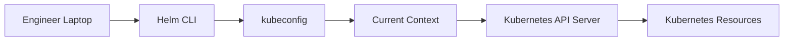

## What Is Helm?

**File:** `01-what-is-helm.md`

## Table of Contents

- [1. Definition](#1-definition)
- [2. Helm as the APT/YUM of Kubernetes](#2-helm-as-the-aptyum-of-kubernetes)
- [3. What Helm Can Do](#3-what-helm-can-do)
- [4. Why Helm](#4-why-helm)
- [5. Helm Installation](#5-helm-installation)
- [6. Helm and Kubernetes Clusters](#6-helm-and-kubernetes-clusters)
- [7. Kubernetes Context](#7-kubernetes-context)
- [8. Practical Lab: Verify Helm](#8-practical-lab-verify-helm)
- [9. Key Commands](#9-key-commands)
- [10. Helm 2 vs Helm 3+](#10-helm-2-vs-helm-3)
- [11. Troubleshooting](#11-troubleshooting)
- [12. Best Practices](#12-best-practices)
- [13. Interview Questions](#13-interview-questions)
- [14. Cleanup](#14-cleanup)

## 1. Definition

**Helm is a package manager for Kubernetes.**

It packages Kubernetes application definitions into reusable units called **charts**.

A chart can contain:

- Kubernetes manifests
- Configuration
- Templates
- Default values
- Dependencies
- Installation notes
- Test hooks

Helm allows teams to install, configure, upgrade, roll back, and uninstall Kubernetes applications using a consistent workflow.

## 2. Helm as the APT/YUM of Kubernetes

A useful analogy is:

```text
Linux                              Kubernetes
---------------------------------------------------------
APT / YUM                          Helm
DEB / RPM                          Helm Chart
Package Repository                 Helm Repository / OCI
Installed Package                  Helm Release
Package Configuration              values.yaml
Package Upgrade                    helm upgrade
Package Removal                    helm uninstall
```

### Linux example

```bash
sudo apt update
sudo apt install python3
```

APT:

1. Finds package metadata.
2. Finds the requested package.
3. Resolves dependencies.
4. Downloads packages.
5. Installs/configures them.

### Kubernetes example

```bash
helm repo add bitnami https://charts.bitnami.com/bitnami
helm repo update

helm install my-nginx bitnami/nginx
```

Helm:

1. Finds the chart repository.
2. Locates the requested chart.
3. Retrieves the chart.
4. Processes chart templates and values.
5. Generates Kubernetes manifests.
6. Sends resources to the Kubernetes API.
7. Tracks the deployment as a release.

## 3. What Helm Can Do

Helm is not limited to installation.

### Install

```bash
helm install myapp ./myapp
```

### Upgrade

```bash
helm upgrade myapp ./myapp
```

### Roll back

```bash
helm rollback myapp 1
```

### Uninstall

```bash
helm uninstall myapp
```

### Package

```bash
helm package ./myapp
```

### Render without deployment

```bash
helm template myapp ./myapp
```

### Validate

```bash
helm lint ./myapp
```

## 4. Why Helm

### Without Helm

Imagine an organization needs to install:

- NGINX
- Prometheus
- Grafana
- Argo CD
- AWS Load Balancer Controller

A manual approach may require:

```text
NGINX
 ├── Deployment
 ├── Service
 └── ConfigMap

Prometheus
 ├── Namespace
 ├── ServiceAccount
 ├── RBAC
 ├── ConfigMap
 ├── StatefulSet
 └── Service

Argo CD
 ├── Namespace
 ├── ServiceAccount
 ├── RBAC
 ├── ConfigMaps
 ├── Deployments
 └── Services
```

A team could maintain scripts and YAML files, but this creates maintenance overhead.

### Version problem

Suppose different teams need:

```text
Team A → Argo CD 2.x
Team B → another supported version
UAT    → 2 replicas
PROD   → 3 replicas
```

Maintaining independent YAML files for every combination quickly becomes difficult.

Helm allows one reusable chart to expose configurable parameters.

```yaml
replicaCount: 3
```

The template can consume:

```yaml
replicas: {{ .Values.replicaCount }}
```

## 5. Helm Installation

Install Helm on the machine from which you will administer Kubernetes.

Current Helm installation methods include package managers such as:

### macOS

```bash
brew install helm
```

### Windows with Chocolatey

```powershell
choco install kubernetes-helm
```

### Windows with WinGet

```powershell
winget install Helm.Helm
```

### Linux

Use the package manager appropriate for the distribution or the official Helm installation procedure.

The current Helm project documents Homebrew, Chocolatey, WinGet, Scoop, Snap, and other installation methods.

## 6. Helm and Kubernetes Clusters

A common question is:

> Do I need to install Helm inside the Kubernetes cluster?

For Helm 3 and later, **no Tiller installation is required**.

Helm runs from the client machine and communicates with the Kubernetes API using the Kubernetes configuration/context.



This is especially useful when one engineer manages multiple clusters.

## 7. Kubernetes Context

Suppose a developer has:

```text
Development Cluster
UAT Cluster
Production Cluster
```

The local Kubernetes configuration contains contexts for these clusters.

Check contexts:

```bash
kubectl config get-contexts
```

Show the current context:

```bash
kubectl config current-context
```

Change context:

```bash
kubectl config use-context <context-name>
```

Helm uses the same Kubernetes client configuration model.

### Important operational rule

Before executing:

```bash
helm install
helm upgrade
helm uninstall
```

verify:

```bash
kubectl config current-context
```

This avoids deploying to the wrong cluster.

## 8. Practical Lab: Verify Helm

### Step 1 — Verify Helm

```bash
helm version
```

Expected result:

```text
version.BuildInfo{
    ...
}
```

The exact output varies by Helm version.

### Step 2 — Verify kubectl

```bash
kubectl version --client
```

### Step 3 — Verify Kubernetes context

```bash
kubectl config current-context
```

### Step 4 — Verify cluster connectivity

```bash
kubectl get nodes
```

### Step 5 — Check Helm help

```bash
helm help
```

### Step 6 — Check available commands

```bash
helm --help
```

## 9. Key Commands

| Command            | Purpose                     |
|--------------------|-----------------------------|
| `helm version`     | Display Helm version        |
| `helm help`        | Display help                |
| `helm create`      | Create chart skeleton       |
| `helm install`     | Install a release           |
| `helm upgrade`     | Upgrade a release           |
| `helm rollback`    | Roll back release           |
| `helm uninstall`   | Remove release              |
| `helm list`        | List releases               |
| `helm status`      | Display release status      |
| `helm history`     | Display release history     |
| `helm repo add`    | Add chart repository        |
| `helm repo update` | Refresh repository metadata |
| `helm search repo` | Search repository charts    |
| `helm show values` | Display chart values        |
| `helm template`    | Render templates locally    |
| `helm lint`        | Validate chart              |
| `helm package`     | Package chart               |
| `helm test`        | Run chart tests             |

## 10. Helm 2 vs Helm 3+

### Helm 2 — Legacy

Helm 2 used:

```text
Helm CLI
   |
   v
Tiller
   |
   v
Kubernetes API
```

Tiller was a server-side component.

### Helm 3+

Helm 3 removed Tiller:

```text
Helm CLI
   |
   v
Kubernetes API
```

This simplified architecture and removed the requirement to deploy Tiller into every cluster.

### Current position

For new work:

- Do not deploy Tiller.
- Use a current supported Helm release.
- Understand Helm 3 because many existing environments still use it.
- Be aware that Helm 4 is now the current major release.

## 11. Troubleshooting

### Problem: `helm: command not found`

Check:

```bash
helm version
```

If unavailable:

- Install Helm.
- Verify the binary is in `PATH`.
- Restart the terminal if necessary.

### Problem: Kubernetes connection failure

Check:

```bash
kubectl config current-context
kubectl get nodes
```

### Problem: Wrong cluster

Check:

```bash
kubectl config get-contexts
kubectl config current-context
```

Switch:

```bash
kubectl config use-context <context-name>
```

### Problem: Access denied

Verify:

```bash
kubectl auth can-i create deployments
```

Also check:

- Kubernetes RBAC
- Cloud IAM integration
- Current identity
- Namespace permissions

## 12. Best Practices

1. Always verify the Kubernetes context before production operations.
2. Pin chart versions in controlled deployments.
3. Review chart values before installation.
4. Use `helm template` before applying unfamiliar charts.
5. Run `helm lint` on charts you maintain.
6. Do not use Helm 2/Tiller for new environments.
7. Keep secrets out of Git.
8. Prefer immutable image tags/digests over `latest` in production.
9. Maintain release history.
10. Use CI/CD to standardize chart validation and deployment.

## 13. Interview Questions

### Q1. What is Helm?

**Answer:**

Helm is a package manager for Kubernetes. It packages Kubernetes resources into reusable charts and provides commands to install, configure, upgrade, roll back, and uninstall applications.

### Q2. Is Helm installed inside Kubernetes?

**Answer:**

Helm runs as a client-side CLI. Helm 3 and later do not require Tiller to be installed in the Kubernetes cluster.

### Q3. How does Helm know which cluster to deploy to?

**Answer:**

Helm uses the Kubernetes client configuration and current context, similar to `kubectl`.

### Q4. What replaced Tiller?

**Answer:**

Helm 3 removed Tiller. The Helm client communicates directly with the Kubernetes API using the user's Kubernetes credentials and permissions.

### Q5. Why use Helm instead of `kubectl apply`?

**Answer:**

`kubectl apply` can deploy Kubernetes manifests, but Helm provides packaging, templating, configurable values, release tracking, upgrades, rollbacks, chart versioning, dependencies, and lifecycle management.

### Q6. What is the Linux analogy for Helm?

**Answer:**

Helm is commonly compared with Linux package managers such as APT or YUM.

### Q7. What should you check before running `helm install` in production?

**Answer:**

At minimum:

```bash
kubectl config current-context
helm show values <chart>
helm template <release> <chart>
helm lint <chart>
```

Also verify namespace, permissions, chart version, values, dependencies, and required Kubernetes resources.

## 14. Cleanup

This introductory lab does not create Kubernetes resources.

If a test release was created during experimentation:

```bash
helm list
helm uninstall <release-name>
```

Then verify:

```bash
helm list
kubectl get pods
```

The cleanup objective is to leave the Kubernetes cluster unchanged.