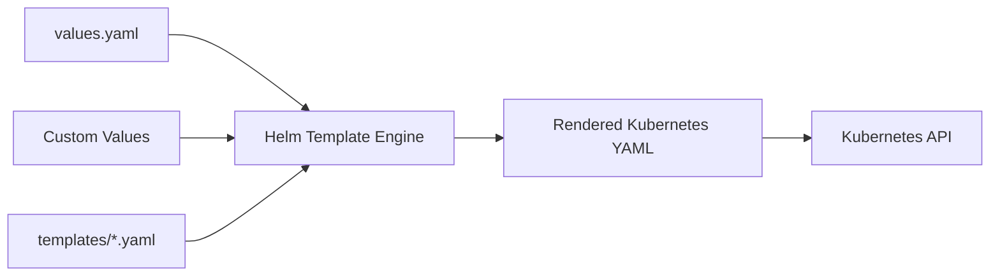

## Components of Helm

**File:** `02-components-of-helm.md`

## Table of Contents

- [1. Helm Components](#1-helm-components)
- [2. Helm Charts](#2-helm-charts)
- [3. Chart Structure](#3-chart-structure)
- [4. Chart.yaml](#4-chartyaml)
- [5. values.yaml](#5-valuesyaml)
- [6. templates](#6-templates)
- [7. charts](#7-charts)
- [8. Helm Repositories](#8-helm-repositories)
- [9. Helm Releases](#9-helm-releases)
- [10. Release Lifecycle](#10-release-lifecycle)
- [11. How the Components Work Together](#11-how-the-components-work-together)
- [12. Interview Questions](#12-interview-questions)
- [13. Cleanup](#13-cleanup)

## 1. Helm Components

The three foundational Helm concepts are:

```text
Chart
Repository
Release
```

Think of them as:

```text
Chart       = Package
Repository  = Package Store
Release     = Installed Package
```

## 2. Helm Charts

A **Helm chart** is a collection of files that defines a Kubernetes application.

A chart can describe:

- Deployments
- Services
- ConfigMaps
- Secrets
- ServiceAccounts
- Ingress
- HPA
- Jobs
- CRDs
- Other Kubernetes resources

A chart can be simple:

```text
nginx
```

or complex:

```text
Application
├── Frontend
├── Backend
├── Database
├── Cache
├── Ingress
├── RBAC
└── Monitoring
```

Create a chart:

```bash
helm create myapp
```

Install it:

```bash
helm install myapp ./myapp
```

## 3. Chart Structure

A modern chart commonly looks like:

```text
myapp/
├── Chart.yaml
├── values.yaml
├── values.schema.json
├── charts/
├── crds/
├── templates/
│   ├── deployment.yaml
│   ├── service.yaml
│   ├── serviceaccount.yaml
│   ├── ingress.yaml
│   ├── _helpers.tpl
│   └── NOTES.txt
├── README.md
└── LICENSE
```

Not every file is mandatory.

The essential elements for a basic chart are:

```text
Chart.yaml
values.yaml
templates/
```

Current Helm documentation also recognizes optional `values.schema.json`, `crds/`, `README.md`, `LICENSE`, and chart dependencies.

## 4. Chart.yaml

`Chart.yaml` contains chart metadata.

Example:

```yaml
apiVersion: v2
name: payments
description: A Helm chart for Kubernetes
type: application
version: 0.1.0
appVersion: "1.0.0"
```

### Important fields

#### `apiVersion`

```yaml
apiVersion: v2
```

`v2` is the normal API version for modern Helm charts.

Helm 3 supports `apiVersion: v2` charts; `v1` exists for older Helm compatibility.

#### `name`

```yaml
name: payments
```

The chart name.

#### `description`

```yaml
description: A Helm chart for Kubernetes
```

Human-readable description.

#### `type`

```yaml
type: application
```

Application charts are deployable.

A library chart provides reusable template functionality and is not itself deployed as an application.

#### `version`

```yaml
version: 0.1.0
```

This is the **chart version**.

It should follow Semantic Versioning.

Example:

```text
0.1.0
0.1.1
0.2.0
1.0.0
```

#### `appVersion`

```yaml
appVersion: "1.0.0"
```

This represents the application version.

It is informational and is different from the chart version.

For example:

```text
Chart version: 0.2.0
Application version: 1.4.7
```

The chart can change while the application version stays the same, or the chart can package a new application version.

## 5. values.yaml

`values.yaml` contains default configuration values.

Example:

```yaml
replicaCount: 1

image:
  repository: nginx
  pullPolicy: IfNotPresent
  tag: ""

service:
  type: ClusterIP
  port: 80
```

A template can consume these values:

```yaml
spec:
  replicas: {{ .Values.replicaCount }}
```

and:

```yaml
image: {{ .Values.image.repository }}:{{ .Values.image.tag }}
```

The value hierarchy is:

```text
Chart values.yaml
       |
       v
User-supplied values file
       |
       v
--set
```

For example:

```bash
helm install myapp ./myapp \
  --set replicaCount=3
```

Or:

```bash
helm install myapp ./myapp \
  --values production-values.yaml
```

User-provided values override chart defaults.

## 6. templates

The `templates/` directory contains Kubernetes manifests with Helm template expressions.

Example:

```yaml
apiVersion: apps/v1
kind: Deployment

metadata:
  name: {{ include "payments.fullname" . }}

spec:
  replicas: {{ .Values.replicaCount }}
```

Helm processes template files and generates Kubernetes manifests.



Helm templates use Go templating plus functions provided by Helm/Sprig.

### `_helpers.tpl`

This file normally contains reusable named templates.

Example:

```yaml
{{/*
Create a reusable application name.
*/}}
{{- define "payments.name" -}}
{{- default .Chart.Name .Values.nameOverride | trunc 63 | trimSuffix "-" }}
{{- end }}
```

Then another template can use:

```yaml
name: {{ include "payments.name" . }}
```

This avoids duplicating naming and labeling logic.

### `NOTES.txt`

`templates/NOTES.txt` displays useful post-install information.

For example:

```text
1. Get the application URL:

http://example.local
```

The file is templated and evaluated by Helm.

Current Helm guidance recommends keeping `NOTES.txt` brief and using it for useful next steps or access instructions.

### Test Hooks

A chart can include Helm tests.

Example:

```yaml
apiVersion: v1
kind: Pod
metadata:
  name: "{{ include "payments.fullname" . }}-test-connection"
  annotations:
    "helm.sh/hook": test

spec:
  containers:
    - name: wget
      image: busybox
      command:
        - wget
      args:
        - "{{ include "payments.fullname" . }}:{{ .Values.service.port }}"

  restartPolicy: Never
```

Execute:

```bash
helm test payments-service
```

## 7. charts

The `charts/` directory is used for chart dependencies.

For example:

```text
payments/
├── Chart.yaml
├── values.yaml
├── templates/
└── charts/
    └── redis/
```

Conceptually:

```text
Payments Chart
     |
     +---- Redis dependency
     |
     +---- Application resources
```

Modern charts can declare dependencies in `Chart.yaml`:

```yaml
dependencies:
  - name: redis
    version: "..."
    repository: "..."
```

Then dependencies can be managed using Helm dependency commands.

## 8. Helm Repositories

A classic Helm repository is a location containing packaged charts and an `index.yaml`.

```text
Repository
│
├── index.yaml
├── payments-0.1.0.tgz
├── payments-0.2.0.tgz
├── shipping-0.1.0.tgz
└── shipping-0.2.0.tgz
```

Add repository:

```bash
helm repo add bitnami https://charts.bitnami.com/bitnami
```

Update metadata:

```bash
helm repo update
```

List repositories:

```bash
helm repo list
```

Search:

```bash
helm search repo bitnami
```

The classic repository model remains supported, but Helm's current documentation recommends considering OCI registries for new repository designs.

## 9. Helm Releases

A **release** is a deployed instance of a chart.

This distinction is extremely important.

```text
Chart
  |
  +---- Release: payments-dev
  |
  +---- Release: payments-uat
  |
  +---- Release: payments-prod
```

The same chart can therefore produce multiple releases.

Install:

```bash
helm install payments-dev ./payments
```

List:

```bash
helm list
```

Status:

```bash
helm status payments-dev
```

History:

```bash
helm history payments-dev
```

Upgrade:

```bash
helm upgrade payments-dev ./payments
```

Rollback:

```bash
helm rollback payments-dev 1
```

Uninstall:

```bash
helm uninstall payments-dev
```

## 10. Release Lifecycle

```mermaid
flowchart LR
    CHART[Chart]
    INSTALL[helm install]
    DEPLOYED[Release Revision 1]
    UPGRADE[helm upgrade]
    REV2[Revision 2]
    ROLLBACK[helm rollback]
    REV1[Revision 1]
    UNINSTALL[helm uninstall]
    REMOVED[Release Removed]

    CHART --> INSTALL
    INSTALL --> DEPLOYED
    DEPLOYED --> UPGRADE
    UPGRADE --> REV2
    REV2 --> ROLLBACK
    ROLLBACK --> REV1
    REV1 --> UNINSTALL
    UNINSTALL --> REMOVED
```



This lifecycle is one of Helm's major operational advantages.

## 11. How the Components Work Together

The complete workflow is:

```text
Chart
  |
  | stored in
  v
Repository
  |
  | selected by user
  v
helm install
  |
  | creates
  v
Release
  |
  | manages
  v
Kubernetes Resources
```

Example:

```bash
helm repo add bitnami https://charts.bitnami.com/bitnami

helm repo update

helm install my-nginx bitnami/nginx
```

Here:

```text
bitnami             = repository
nginx               = chart
my-nginx            = release
```

## 12. Interview Questions

### Q1. What is a Helm chart?

A Helm chart is a package containing templates, configuration, metadata, and optionally dependencies used to deploy Kubernetes resources.

### Q2. What is the difference between a chart and a release?

A chart is the package/template definition. A release is a deployed instance of that chart.

### Q3. Can one chart create multiple releases?

Yes.

Example:

```bash
helm install payments-dev ./payments
helm install payments-uat ./payments
helm install payments-prod ./payments
```

### Q4. What is `values.yaml`?

It contains default configuration values consumed by templates. Users can override them with additional values files or `--set`.

### Q5. What is `Chart.yaml`?

It contains metadata such as chart name, chart version, application version, chart type, description, and dependencies.

### Q6. What is `templates/`?

It contains Helm templates that are rendered into Kubernetes manifests.

### Q7. What is `_helpers.tpl`?

It contains reusable named template helpers, commonly for names, labels, selectors, and service-account naming.

### Q8. What is the difference between `version` and `appVersion`?

`version` identifies the Helm chart version. `appVersion` describes the application version packaged by the chart.

### Q9. What is a Helm repository?

A classic Helm repository is an HTTP-served location containing packaged charts and an `index.yaml`.

### Q10. What is the modern alternative to a classic Helm repository?

OCI-compatible registries are a modern distribution option and are particularly useful when an organization already has an enterprise container registry.

## 13. Cleanup

If you created a test release:

```bash
helm list
helm uninstall <release-name>
```

If a temporary repository was added:

```bash
helm repo list
helm repo remove <repo-name>
```

Verify:

```bash
helm list
helm repo list
```

No Kubernetes resources from the exercise should remain.