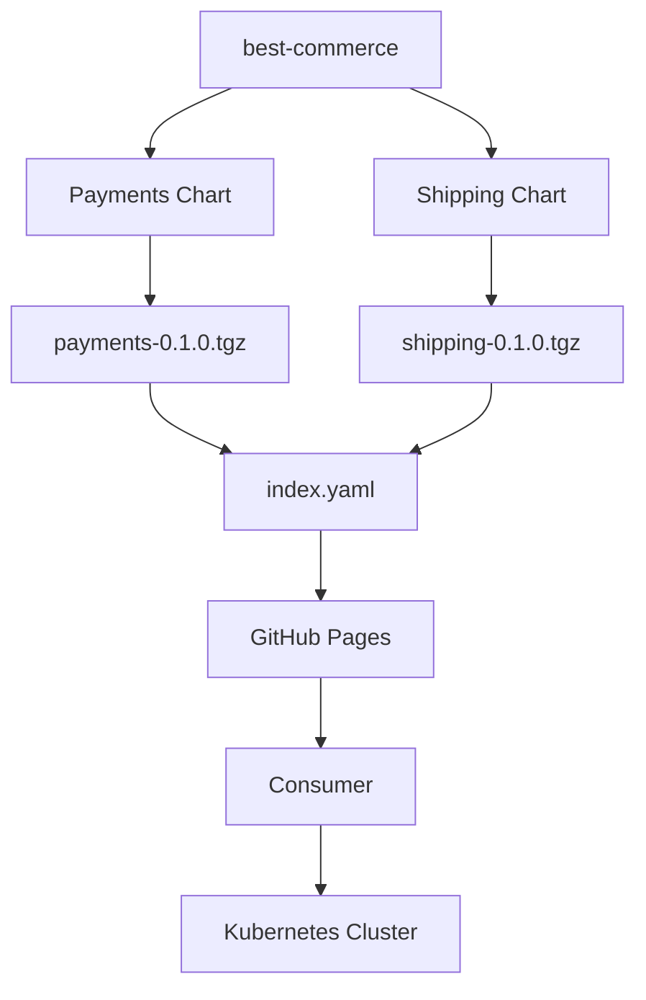

## Creating Helm Charts for Payments and Shipping Services

**File:** `04-create-helm-chart.md`

## Table of Contents

- [1. Scenario](#1-scenario)
- [2. Objective](#2-objective)
- [3. Architecture](#3-architecture)
- [4. Prerequisites](#4-prerequisites)
- [5. Create the Chart Directories](#5-create-the-chart-directories)
- [6. Generate Charts](#6-generate-charts)
- [7. Understand the Generated Structure](#7-understand-the-generated-structure)
- [8. Customize the Payments Chart](#8-customize-the-payments-chart)
- [9. Customize the Shipping Chart](#9-customize-the-shipping-chart)
- [10. Validate Charts](#10-validate-charts)
- [11. Package the Charts](#11-package-the-charts)
- [12. Create the Chart Repository](#12-create-the-chart-repository)
- [13. Publish Using GitHub Pages](#13-publish-using-github-pages)
- [14. Consume the Repository](#14-consume-the-repository)
- [15. Complete Repository Structure](#15-complete-repository-structure)
- [16. Chart Files](#16-chart-files)
- [17. Real-World Explanation](#17-real-world-explanation)
- [18. Classic Repository vs OCI](#18-classic-repository-vs-oci)
- [19. Troubleshooting](#19-troubleshooting)
- [20. Best Practices](#20-best-practices)
- [21. Interview Questions](#21-interview-questions)
- [22. Cleanup](#22-cleanup)
- [23. Final Summary](#23-final-summary)

## 1. Scenario

Assume an e-commerce organization called:

```text
best-commerce
```

The organization has two microservices:

```text
Payments
Shipping
```

The DevOps team wants to package both applications as Helm charts.

The final relationship is:

```text
best-commerce
│
├── payments Helm Chart
│
└── shipping Helm Chart
```

The two charts can then be distributed through a common repository.

## 2. Objective

By completing this lab, you will learn how to:

- Create Helm charts.
- Understand the generated chart structure.
- Customize `Chart.yaml`.
- Customize `values.yaml`.
- Create deployment templates.
- Use Helm template variables.
- Package charts.
- Generate `index.yaml`.
- Create a classic Helm repository.
- Host charts on GitHub Pages.
- Add the repository to Helm.
- Search the repository.
- Install charts from it.
- Validate the charts.
- Understand production improvements.

## 3. Architecture



## 4. Prerequisites

Install:

- Helm
- kubectl
- Git
- Kubernetes cluster
- GitHub account
- Access to GitHub Pages

Verify:

```bash
helm version
kubectl version --client
git --version
kubectl config current-context
kubectl get nodes
```

## 5. Create the Chart Directories

The basic shell command is:

```bash
mkdir -p best-commerce/{payments,shipping}
```

Move into the directory:

```bash
cd best-commerce
```

Result:

```text
best-commerce/
├── payments/
└── shipping/
```

## 6. Generate Charts

Helm provides the `helm create` command.

```bash
helm create payments
```

Then:

```bash
helm create shipping
```

Verify:

```bash
ls
```

Expected:

```text
payments
shipping
```

The generated structure is similar to:

```text
payments/
├── Chart.yaml
├── values.yaml
├── charts/
├── templates/
└── ...
```

and:

```text
shipping/
├── Chart.yaml
├── values.yaml
├── charts/
├── templates/
└── ...
```

This is similar conceptually to project scaffolding tools that generate a standard starting structure.

## 7. Understand the Generated Structure

The most important elements are:

```text
Chart.yaml
values.yaml
templates/
```

The generated `charts/` directory is intended for dependencies.

For example:

```text
payments
   |
   +---- Redis dependency
```

or:

```text
payments
   |
   +---- Valkey dependency
```

The dependency mechanism can be managed through `Chart.yaml`.

For this exercise, no dependency is required.

### `Chart.yaml`

Contains chart metadata.

```yaml
apiVersion: v2
name: payments
description: A Helm chart for Kubernetes
type: application
version: 0.1.0
appVersion: "1.0.0"
```

### `templates/`

Contains Kubernetes resource templates.

Examples:

```text
templates/
├── deployment.yaml
├── service.yaml
├── serviceaccount.yaml
├── ingress.yaml
├── hpa.yaml
├── _helpers.tpl
├── NOTES.txt
└── tests/
    └── test-connection.yaml
```

The important concept is:

> Whatever Kubernetes resources the application requires can be represented as templates under `templates/`.

For example:

```text
Deployment
Service
ConfigMap
Secret
ServiceAccount
Ingress
HPA
```

### `values.yaml`

Contains configurable values.

For example:

```yaml
image:
  repository: busybox
  tag: latest
  pullPolicy: IfNotPresent

appMessage: "Payments Service"
```

## 8. Customize the Payments Chart

### 8.1 Deployment Template

For this demonstration, replace the generated deployment template with:

```yaml
apiVersion: apps/v1
kind: Deployment

metadata:
  # Release.Name identifies the Helm release.
  # Chart.Name identifies the chart.
  name: {{ .Release.Name }}-{{ .Chart.Name }}

  labels:
    app: {{ .Chart.Name }}

spec:
  # One replica is sufficient for this demonstration.
  replicas: 1

  selector:
    matchLabels:
      app: {{ .Chart.Name }}

  template:
    metadata:
      labels:
        app: {{ .Chart.Name }}

    spec:
      containers:
        - name: {{ .Chart.Name }}

          # Image repository and tag come from values.yaml.
          image: {{ .Values.image.repository }}:{{ .Values.image.tag }}

          # BusyBox prints the application message and remains alive.
          command:
            - sh
            - -c
            - 'echo {{ .Values.appMessage }}; sleep 3600'

          # Pull policy also comes from values.yaml.
          imagePullPolicy: {{ .Values.image.pullPolicy }}
```

### 8.2 Understanding the Variables

Consider:

```yaml
name: {{ .Release.Name }}-{{ .Chart.Name }}
```

`Release.Name`:

```text
payments-service
```

`Chart.Name`:

```text
payments
```

Result:

```text
payments-service-payments
```

### `.Values`

This:

```yaml
{{ .Values.image.repository }}
```

reads:

```yaml
image:
  repository: busybox
```

Therefore:

```text
.Values.image.repository
        |
        v
busybox
```

### Application Message

This:

```yaml
{{ .Values.appMessage }}
```

reads:

```yaml
appMessage: "Payments Service"
```

and the container executes:

```bash
echo Payments Service
```

### 8.3 Customize `values.yaml`

Replace the generated `values.yaml` with:

```yaml
# Default values for the payments chart.

image:
  # Container image used by the demonstration application.
  repository: busybox

  # Demonstration tag.
  #
  # Production applications should normally pin an immutable version
  # or image digest instead of using "latest".
  tag: latest

  # Pull the image when it is not already present on the node.
  pullPolicy: IfNotPresent

# Message printed by the BusyBox container.
appMessage: "Payments Service"
```

The resulting flow is:

```text
values.yaml
     |
     v
.Values.image.repository
     |
     v
busybox
```

and:

```text
values.yaml
     |
     v
.Values.appMessage
     |
     v
Payments Service
```

## 9. Customize the Shipping Chart

The Shipping chart follows the same pattern.

This is intentional.

In a real organization, multiple microservices frequently use the same chart design but different:

- Image repositories
- Image tags
- Ports
- Replicas
- Resources
- Environment variables
- Service configuration

### 9.1 Shipping Deployment

```yaml
apiVersion: apps/v1
kind: Deployment

metadata:
  name: {{ .Release.Name }}-{{ .Chart.Name }}

  labels:
    app: {{ .Chart.Name }}

spec:
  replicas: 1

  selector:
    matchLabels:
      app: {{ .Chart.Name }}

  template:
    metadata:
      labels:
        app: {{ .Chart.Name }}

    spec:
      containers:
        - name: {{ .Chart.Name }}

          image: {{ .Values.image.repository }}:{{ .Values.image.tag }}

          command:
            - sh
            - -c
            - 'echo {{ .Values.appMessage }}; sleep 3600'

          imagePullPolicy: {{ .Values.image.pullPolicy }}
```

### 9.2 Shipping `values.yaml`

```yaml
image:
  repository: busybox
  tag: latest
  pullPolicy: IfNotPresent

appMessage: "Shipping Service"
```

## 10. Validate Charts

Before packaging, validate both charts.

From:

```text
best-commerce/
```

run:

```bash
helm lint payments
```

and:

```bash
helm lint shipping
```

### Render Payments

```bash
helm template payments-test ./payments
```

Inspect the generated Deployment.

You should see values rendered rather than template expressions such as:

```text
{{ .Values.image.repository }}
```

For example:

```yaml
image: busybox:latest
```

### Render Shipping

```bash
helm template shipping-test ./shipping
```

### Dry Run

```bash
helm install payments-test ./payments \
  --dry-run \
  --debug
```

And:

```bash
helm install shipping-test ./shipping \
  --dry-run \
  --debug
```

## 11. Package the Charts

Move to:

```bash
cd ..
```

You should now be in:

```text
best-commerce/
```

Package Shipping:

```bash
helm package shipping
```

This creates:

```text
shipping-0.1.0.tgz
```

Package Payments:

```bash
helm package payments
```

This creates:

```text
payments-0.1.0.tgz
```

A `.tgz` file is the packaged Helm chart.

Conceptually:

```text
shipping/
    |
    | helm package
    v
shipping-0.1.0.tgz
```

## 12. Create the Chart Repository

The classic Helm repository requires an `index.yaml`.

Run:

```bash
helm repo index .
```

Now:

```text
best-commerce/
├── payments/
├── shipping/
├── payments-0.1.0.tgz
├── shipping-0.1.0.tgz
└── index.yaml
```

### Inspect `index.yaml`

```bash
cat index.yaml
```

The generated file contains metadata similar to:

```yaml
apiVersion: v1

entries:
  payments:
    - apiVersion: v2
      appVersion: 1.0.0
      description: A Helm chart for Kubernetes
      name: payments
      type: application
      urls:
        - payments-0.1.0.tgz
      version: 0.1.0

  shipping:
    - apiVersion: v2
      appVersion: 1.16.0
      description: A Helm chart for Kubernetes
      name: shipping
      type: application
      urls:
        - shipping-0.1.0.tgz
      version: 0.1.0
```

The exact timestamps and digests will differ because Helm generates them.

### Important Version Detail

The chart version:

```yaml
version: 0.1.0
```

controls the package version:

```text
payments-0.1.0.tgz
```

If you change the chart:

```yaml
version: 0.2.0
```

then package again:

```bash
helm package payments
```

and you will obtain:

```text
payments-0.2.0.tgz
```

The chart version should therefore be incremented whenever the chart itself changes.

## 13. Publish Using GitHub Pages

Create a GitHub repository.

Example:

```text
helm-repo
```

Initialize Git:

```bash
git init
```

Set the branch:

```bash
git branch -M main
```

Add the remote:

```bash
git remote add origin https://github.com/<username>/helm-repo.git
```

Add files:

```bash
git add .
```

Commit:

```bash
git commit -m "feat(helm): add payments and shipping charts"
```

Push:

```bash
git push -u origin main
```

### Enable GitHub Pages

In the GitHub repository:

```text
Settings
   |
   +-- Pages
        |
        +-- Deploy from branch
        |
        +-- main
        |
        +-- / (root)
```

The resulting URL follows the form:

```text
https://<username>.github.io/helm-repo/
```

The URL must expose:

```text
index.yaml
payments-0.1.0.tgz
shipping-0.1.0.tgz
```

## 14. Consume the Repository

On another machine, or from a clean Helm environment:

```bash
helm repo add myrepo https://<username>.github.io/helm-repo
```

Update:

```bash
helm repo update
```

Search:

```bash
helm search repo myrepo
```

You should see:

```text
myrepo/payments
myrepo/shipping
```

### Install Payments

```bash
helm install payments-service myrepo/payments
```

Verify:

```bash
helm list
kubectl get pods
```

### Install Shipping

```bash
helm install shipping-service myrepo/shipping
```

Verify:

```bash
helm list
kubectl get pods
```

The result is:

```text
Release                  Chart
------------------------------------------------
payments-service         myrepo/payments
shipping-service         myrepo/shipping
```

## 15. Complete Repository Structure

The final professional repository is:

```text
Helm-Guide/
│
├── .gitignore
├── README.md
│
├── docs/
│   ├── 01-what-is-helm.md
│   ├── 02-components-of-helm.md
│   ├── 03-deploy-helm-chart.md
│   └── 04-create-helm-chart.md
│
├── examples/
│   └── best-commerce/
│       ├── payments/
│       │   ├── templates/
│       │   │   ├── tests/
│       │   │   │   └── test-connection.yaml
│       │   │   ├── _helpers.tpl
│       │   │   ├── deployment.yaml
│       │   │   ├── hpa.yaml
│       │   │   ├── ingress.yaml
│       │   │   ├── service.yaml
│       │   │   └── serviceaccount.yaml
│       │   ├── .helmignore
│       │   ├── Chart.yaml
│       │   ├── NOTES.txt
│       │   └── values.yaml
│       │
│       └── shipping/
│           ├── templates/
│           │   ├── tests/
│           │   │   └── test-connection.yaml
│           │   ├── _helpers.tpl
│           │   ├── deployment.yaml
│           │   ├── hpa.yaml
│           │   ├── ingress.yaml
│           │   ├── service.yaml
│           │   └── serviceaccount.yaml
│           ├── .helmignore
│           ├── Chart.yaml
│           ├── NOTES.txt
│           └── values.yaml
│
└── charts/
    ├── index.yaml
    ├── payments-0.1.0.tgz
    └── shipping-0.1.0.tgz
```

## 16. Chart Files

The generated chart contains more than the simplified Deployment and values used in the demonstration.

These files are valuable because they demonstrate the standard chart structure.

### 16.1 `templates/_helpers.tpl`

For Payments:

```yaml
{{/*
Expand the name of the chart.
*/}}
{{- define "payments.name" -}}
{{- default .Chart.Name .Values.nameOverride | trunc 63 | trimSuffix "-" }}
{{- end }}

{{/*
Create a default fully qualified app name.
*/}}
{{- define "payments.fullname" -}}
{{- if .Values.fullnameOverride }}
{{- .Values.fullnameOverride | trunc 63 | trimSuffix "-" }}
{{- else }}
{{- $name := default .Chart.Name .Values.nameOverride }}
{{- if contains $name .Release.Name }}
{{- .Release.Name | trunc 63 | trimSuffix "-" }}
{{- else }}
{{- printf "%s-%s" .Release.Name $name | trunc 63 | trimSuffix "-" }}
{{- end }}
{{- end }}
{{- end }}

{{/*
Create chart name and version.
*/}}
{{- define "payments.chart" -}}
{{- printf "%s-%s" .Chart.Name .Chart.Version | replace "+" "_" | trunc 63 | trimSuffix "-" }}
{{- end }}

{{/*
Common labels.
*/}}
{{- define "payments.labels" -}}
helm.sh/chart: {{ include "payments.chart" . }}
{{ include "payments.selectorLabels" . }}
{{- if .Chart.AppVersion }}
app.kubernetes.io/version: {{ .Chart.AppVersion | quote }}
{{- end }}
app.kubernetes.io/managed-by: {{ .Release.Service }}
{{- end }}

{{/*
Selector labels.
*/}}
{{- define "payments.selectorLabels" -}}
app.kubernetes.io/name: {{ include "payments.name" . }}
app.kubernetes.io/instance: {{ .Release.Name }}
{{- end }}

{{/*
Service account name.
*/}}
{{- define "payments.serviceAccountName" -}}
{{- if .Values.serviceAccount.create }}
{{- default (include "payments.fullname" .) .Values.serviceAccount.name }}
{{- else }}
{{- default "default" .Values.serviceAccount.name }}
{{- end }}
{{- end }}
```

Shipping uses the same pattern with `shipping` instead of `payments`.

### 16.2 `templates/service.yaml`

Payments:

```yaml
apiVersion: v1
kind: Service

metadata:
  name: {{ include "payments.fullname" . }}
  labels:
    {{- include "payments.labels" . | nindent 4 }}

spec:
  type: {{ .Values.service.type }}

  ports:
    - port: {{ .Values.service.port }}
      targetPort: http
      protocol: TCP
      name: http

  selector:
    {{- include "payments.selectorLabels" . | nindent 4 }}
```

This provides a stable Kubernetes network endpoint for the application.

### 16.3 `templates/serviceaccount.yaml`

```yaml
{{- if .Values.serviceAccount.create -}}

apiVersion: v1
kind: ServiceAccount

metadata:
  name: {{ include "payments.serviceAccountName" . }}

  labels:
    {{- include "payments.labels" . | nindent 4 }}

  {{- with .Values.serviceAccount.annotations }}
  annotations:
    {{- toYaml . | nindent 4 }}
  {{- end }}

automountServiceAccountToken: {{ .Values.serviceAccount.automount }}

{{- end }}
```

The resource is generated only when:

```yaml
serviceAccount:
  create: true
```

### 16.4 `templates/hpa.yaml`

The generated chart uses:

```yaml
{{- if .Values.autoscaling.enabled }}

apiVersion: autoscaling/v2
kind: HorizontalPodAutoscaler

metadata:
  name: {{ include "payments.fullname" . }}

spec:
  scaleTargetRef:
    apiVersion: apps/v1
    kind: Deployment
    name: {{ include "payments.fullname" . }}

  minReplicas: {{ .Values.autoscaling.minReplicas }}
  maxReplicas: {{ .Values.autoscaling.maxReplicas }}

  metrics:
    {{- if .Values.autoscaling.targetCPUUtilizationPercentage }}
    - type: Resource
      resource:
        name: cpu
        target:
          type: Utilization
          averageUtilization: {{ .Values.autoscaling.targetCPUUtilizationPercentage }}
    {{- end }}

{{- end }}
```

The important concept is conditional rendering:

```yaml
{{- if .Values.autoscaling.enabled }}
```

When:

```yaml
autoscaling:
  enabled: false
```

the HPA is not rendered.

### 16.5 `templates/ingress.yaml`

The generated structure supports:

```yaml
{{- if .Values.ingress.enabled -}}
```

and dynamically creates:

- Ingress class
- TLS configuration
- Hosts
- Paths
- Service backend

This demonstrates how one chart can support multiple environments.

For example:

```yaml
ingress:
  enabled: true
```

can activate the resource.

### 16.6 `templates/tests/test-connection.yaml`

```yaml
apiVersion: v1
kind: Pod

metadata:
  name: "{{ include "payments.fullname" . }}-test-connection"

  labels:
    {{- include "payments.labels" . | nindent 4 }}

  annotations:
    "helm.sh/hook": test

spec:
  containers:
    - name: wget
      image: busybox
      command:
        - wget
      args:
        - "{{ include "payments.fullname" . }}:{{ .Values.service.port }}"

  restartPolicy: Never
```

Execute:

```bash
helm test payments-service
```

### 16.7 `NOTES.txt`

The standard chart notes can provide:

- Ingress URL
- NodePort access
- LoadBalancer status
- ClusterIP port-forward instructions

Example:

```text
1. Get the application URL by running these commands:
```

For ClusterIP:

```bash
kubectl port-forward ...
```

This is useful because Helm prints `NOTES.txt` after installation.

### 16.8 `.helmignore`

A `.helmignore` controls files excluded when packaging a chart.

Typical entries:

```text
.DS_Store

.git/
.gitignore

.bzr/
.bzrignore

.hg/
.hgignore

.svn/

*.swp
*.bak
*.tmp
*.orig
*~

.project
.idea/
*.tmproj
.vscode/
```

This prevents irrelevant development files from entering the packaged chart.

## 17. Real-World Explanation

In a real organization, the BusyBox example would be replaced by the application's actual container image.

For Payments:

```yaml
image:
  repository: registry.example.com/payments
  tag: "1.4.2"
```

For Shipping:

```yaml
image:
  repository: registry.example.com/shipping
  tag: "2.7.1"
```

The deployment template can remain largely reusable.

This is the fundamental Helm idea:

```text
Same Template
      +
Different Values
      =
Different Deployments
```

## 18. Classic Repository vs OCI

The lab intentionally demonstrates the classic Helm repository model:

```text
index.yaml
    +
chart.tgz files
```

Helm's current documentation notes that classic repositories remain valid but recommends considering OCI registries for new repository designs.

OCI workflow:

```text
Helm Chart
    |
    | helm package
    v
Chart Package
    |
    | helm push
    v
OCI Registry
```

Examples include:

```text
Amazon ECR
Azure Container Registry
Harbor
JFrog Artifactory
Google Artifact Registry
```

OCI support is built into modern Helm; it became generally available in Helm 3.8.0.

### OCI Example

Login:

```bash
helm registry login <registry>
```

Push:

```bash
helm push payments-0.1.0.tgz oci://<registry>/helm
```

Install:

```bash
helm install payments \
  oci://<registry>/helm/payments \
  --version 0.1.0
```

Digest-based installation can provide stronger immutability guarantees than mutable tags.

## 19. Troubleshooting

### `helm package` fails

Check:

```bash
helm lint payments
```

Check `Chart.yaml`:

```yaml
version: 0.1.0
```

The package version must correspond to the chart version.

### `helm repo index` does not include a chart

Verify that the package exists:

```bash
ls *.tgz
```

Then regenerate:

```bash
helm repo index .
```

### Repository added but chart not found

Run:

```bash
helm repo update
helm search repo myrepo
```

Verify the hosted URL exposes:

```text
index.yaml
```

### Template rendering fails

Run:

```bash
helm template payments ./payments --debug
```

Then:

```bash
helm lint ./payments
```

Look for:

- Incorrect indentation
- Missing values
- Invalid template syntax
- Incorrect helper names
- Missing quotes
- Invalid Kubernetes YAML

### Kubernetes deployment fails

First render:

```bash
helm template payments ./payments
```

Then inspect the generated manifest.

After deployment:

```bash
helm status payments-service
kubectl get pods
kubectl describe pod <pod-name>
kubectl logs <pod-name>
```

## 20. Best Practices

### 20.1 Do not use `latest` in production

The demonstration uses:

```yaml
tag: latest
```

because it is simple.

Production should preferably use an immutable version:

```yaml
tag: "1.4.2"
```

or an immutable image digest.

### 20.2 Version charts properly

Use Semantic Versioning:

```text
MAJOR.MINOR.PATCH
```

Examples:

```text
0.1.0
0.1.1
0.2.0
1.0.0
```

### 20.3 Separate chart and application versions

Example:

```yaml
version: 0.4.0
appVersion: "2.1.7"
```

This means:

```text
Helm chart → 0.4.0
Application → 2.1.7
```

### 20.4 Use values files for environments

For example:

```text
values.yaml
values-dev.yaml
values-uat.yaml
values-prod.yaml
```

Deployment:

```bash
helm upgrade --install payments \
  ./payments \
  -f values-prod.yaml
```

### 20.5 Validate before deployment

Use:

```bash
helm lint ./payments
helm template payments ./payments
helm install payments ./payments --dry-run --debug
```

### 20.6 Keep secrets out of Git

Do not put:

```yaml
password: MySecretPassword
```

into Git.

Use an appropriate secret-management strategy such as:

- Kubernetes Secrets with appropriate controls
- External Secrets
- Cloud secret managers
- Vault
- Sealed Secrets
- CI/CD secret injection

### 20.7 Use reusable helpers

Instead of repeating:

```yaml
app.kubernetes.io/name: payments
app.kubernetes.io/instance: payments-prod
```

centralize labels in `_helpers.tpl`.

### 20.8 Use schema validation where appropriate

Modern charts can include:

```text
values.schema.json
```

to validate values supplied to:

```bash
helm install
helm upgrade
helm lint
helm template
```

This helps catch invalid configuration earlier.

## 21. Interview Questions

### Q1. How do you create a Helm chart?

```bash
helm create payments
```

Then customize:

```text
Chart.yaml
values.yaml
templates/
```

### Q2. What does `helm create` do?

It generates a standard chart skeleton containing metadata, default values, templates, helpers, tests, and supporting files.

### Q3. Why use `values.yaml`?

To separate configurable parameters from Kubernetes templates.

### Q4. How does Helm pass values into templates?

Through the `.Values` object.

Example:

```yaml
image: {{ .Values.image.repository }}:{{ .Values.image.tag }}
```

### Q5. What is `.Release.Name`?

It is the name assigned to the deployed Helm release.

### Q6. What is `.Chart.Name`?

It is the name defined in `Chart.yaml`.

### Q7. Why use `_helpers.tpl`?

To define reusable template functions for names, labels, selectors, service accounts, and similar logic.

### Q8. How do you package a Helm chart?

```bash
helm package payments
```

### Q9. What is `index.yaml`?

In a classic Helm repository, `index.yaml` contains metadata describing available packaged charts and their versions.

### Q10. How do you create the repository index?

```bash
helm repo index .
```

### Q11. How can you host a Helm repository?

A classic repository can be hosted on an HTTP server or static hosting such as GitHub Pages. Enterprise environments can also use artifact platforms.

Modern Helm workflows can instead use OCI-compatible registries.

### Q12. What is the difference between chart version and application version?

Example:

```yaml
version: 0.3.0
appVersion: "2.5.1"
```

`0.3.0` is the Helm chart version.

`2.5.1` identifies the application version.

### Q13. Why use BusyBox in this lab?

BusyBox provides a small, readily available container image, allowing the Helm deployment mechanism to be demonstrated without introducing unnecessary application source code.

### Q14. How would you adapt this example for production?

I would:

1. Use the real application images.
2. Pin immutable image versions/digests.
3. Configure resource requests/limits.
4. Configure readiness/liveness/startup probes.
5. Configure environment-specific values.
6. Add security contexts.
7. Configure RBAC appropriately.
8. Add ingress where required.
9. Validate with CI.
10. Version the chart.
11. Use an enterprise artifact/OCI registry.
12. Add automated deployment through CI/CD.

### Q15. What happens if the same chart is used in UAT and production?

The same chart can be deployed as different releases with different values.

Example:

```bash
helm upgrade --install payments-uat ./payments \
  -f values-uat.yaml
```

and:

```bash
helm upgrade --install payments-prod ./payments \
  -f values-prod.yaml
```

## 22. Cleanup

### 22.1 Remove Payments

```bash
helm uninstall payments-service
```

### 22.2 Remove Shipping

```bash
helm uninstall shipping-service
```

Verify:

```bash
helm list
kubectl get pods
```

### 22.3 Remove the Local Chart Repository

If the repository was added locally:

```bash
helm repo remove myrepo
```

### 22.4 Remove Generated Packages

If the package artifacts are only temporary:

```bash
rm payments-0.1.0.tgz
rm shipping-0.1.0.tgz
rm index.yaml
```

If they are part of the GitHub Pages repository, **do not delete them**.

### 22.5 Remove GitHub Pages

If this was a temporary exercise:

1. Remove the repository or disable GitHub Pages.
2. Remove the repository from your Helm client.
3. Verify no Kubernetes releases remain.

## 23. Final Summary

The complete Helm workflow can be remembered as:

```text
                    HELM
                      |
          +-----------+-----------+
          |           |           |
        Chart      Repository   Release
          |           |           |
       Package      Store       Instance
          |           |           |
          +-----------+-----------+
                      |
                      v
              Kubernetes Cluster
```

The practical workflow is:

```bash
# 1. Add repository
helm repo add <repo> <url>

# 2. Refresh repository metadata
helm repo update

# 3. Search
helm search repo <repo>

# 4. Inspect configuration
helm show values <repo>/<chart>

# 5. Preview
helm template <release> <repo>/<chart>

# 6. Install
helm install <release> <repo>/<chart>

# 7. Verify
helm status <release>
helm list
kubectl get pods

# 8. Upgrade
helm upgrade <release> <repo>/<chart>

# 9. Check history
helm history <release>

# 10. Roll back
helm rollback <release> <revision>

# 11. Uninstall
helm uninstall <release>
```

For your own applications:

```bash
# Create
helm create payments

# Validate
helm lint payments

# Render
helm template payments-test ./payments

# Package
helm package payments

# Build classic repository metadata
helm repo index .

# Or distribute through an OCI registry
helm push payments-0.1.0.tgz oci://<registry>/helm
```

The central Helm concept is therefore:

> A Helm chart turns Kubernetes deployment definitions into a reusable, configurable, versioned application package that can be installed as one or more releases.

The classic `index.yaml` repository workflow in this guide is still valid, while **OCI-based chart distribution is the modern direction to understand for current enterprise Helm usage**.